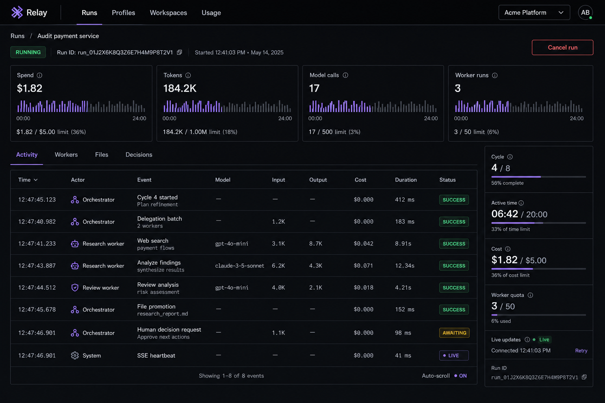

# MVP interface direction

The MVP uses a single dark, technical screen focused on the Goal, the orchestration trace, and the final answer. The approved image remains a mood reference, not a requirement to reproduce its dashboard complexity.

## Foundation

- React and TypeScript with Vite
- Tailwind CSS backed by project-owned CSS-variable tokens
- Radix primitives only when an accessible primitive is needed
- Native `EventSource` for live updates
- No router, Redux, broad component kit, or dashboard theme

### Visual tokens

- Background: `#090A0D`
- Surface: `#0E1015`
- Border: `#262932`
- Primary text: `#F4F4F5`
- Muted text: `#8B909C`
- Accent: `#A78BFA`
- Success: `#34D399`
- Warning: `#FBBF24`
- Danger: `#F87171`
- Interface typeface: Inter
- Numeric and identifier typeface: JetBrains Mono
- Spacing: 4px base scale

## Screen structure

1. Header with connection state and accumulated usage.
2. Goal composer when no run is active.
3. Active-run status with a cancel action.
4. Chronological orchestration trace showing decisions, Delegations, and Worker Results.
5. Final answer when the run completes.
6. Compact recent-run list.

Keep the Goal and final answer visually dominant. Show technical details progressively inside each trace item instead of adding tabs or separate pages.

## Interaction

- Connect to SSE while viewing the active run.
- Replace local state with the snapshot received on every connection.
- Append live updates after the snapshot.
- Keep the latest known state visible during reconnection.
- Disable creation while a run is active.
- Confirm cancellation because it cannot be undone.
- Use functional motion only, generally 100–200ms.
- Provide visible keyboard focus and semantic status labels.
- Never communicate status by color alone.
- Respect reduced-motion preferences.

The single screen must remain usable on mobile and desktop. There are no desktop-only MVP operations.
